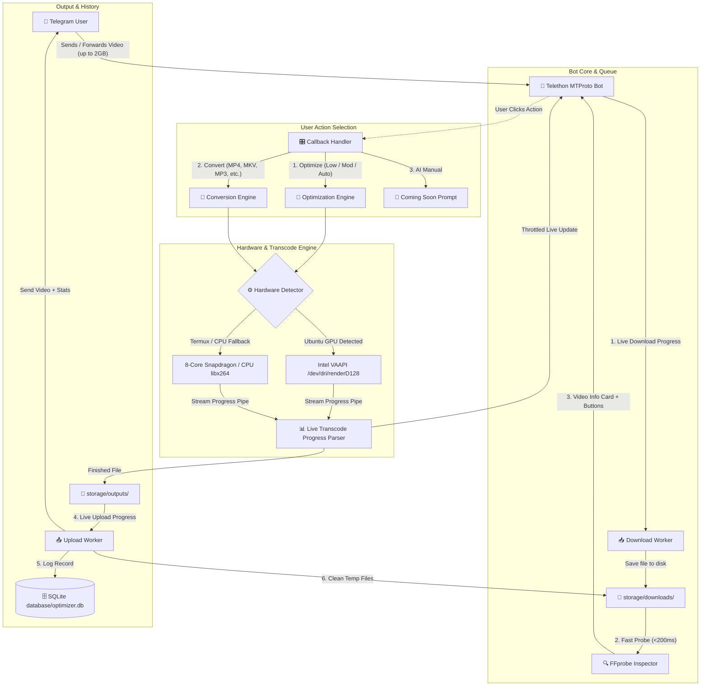

# High-Performance Telegram Video Optimizer & Converter Bot

## Goal Description
Build an asynchronous, modular Telegram bot that automatically ingests any incoming video format, probes its metadata, and provides an interactive inline menu with three primary workflows:
1. **Optimize**:
   - `📱 Low Device Optimize`: High compatibility (H.264 Baseline/Main profile, YUV420p, restrained bitrate for budget/older devices).
   - `💻 Moderate`: Balanced high-profile encoding with mid-range bitrate and crisp fidelity.
   - `⚡ Auto Recommended`: Smart analyzer that detects bitrate bloat (e.g. a 40s video taking 500MB at ~100 Mbps) and automatically computes optimal resolution, CRF, maxrate, and `-movflags +faststart` to achieve up to 90-95% compression with perceptually lossless visual quality.
2. **Convert**:
   - Video container & codec conversions: MP4 (H.264), MKV, AVI, WEBM (VP9/Opus), MOV, MPG.
   - Audio extraction: MP3, AAC (M4A), OGG (Opus), WAV.
3. **AI Manual (Placeholder)**:
   - Graceful prompt explaining that AI Manual mode will be introduced in a future release.

The bot supports **large videos (up to 2GB / 2000MB)** without failing Telegram's standard 20MB Bot API limitation, features **live progress reporting** during download, transcoding, and upload, auto-detects hardware acceleration (`VAAPI` GPU on Ubuntu, multi-threaded Snapdragon 636 CPU on Termux Android 10), and records task history and performance metrics in an async SQLite database.

---

## User Review Required

> [!IMPORTANT]
> **Telegram Large File Download (>20MB up to 2GB) & Credentials**:
> Standard Telegram Bot API (`https://api.telegram.org`) restricts bot downloads to a maximum of **20MB**. A 500MB forwarded video will immediately fail on standard Bot API with `File is too big`.
> To overcome this natively without needing an external C++ local server binary on Android 10, this bot is architected on **Telethon** (MTProto client running in Bot mode). Telethon natively downloads and uploads files up to **2,000 MB (2 GB)** directly from Telegram's datacenters with chunked parallel streaming and progress callbacks.
> 
> Telethon requires three parameters:
> 1. `BOT_TOKEN` (Your Telegram Bot Token from @BotFather)
> 2. `TELEGRAM_API_ID` (An integer obtained in 1 minute from https://my.telegram.org)
> 3. `TELEGRAM_API_HASH` (A 32-character string obtained from https://my.telegram.org)
> 
> *Note:* We will place default configuration slots in `.env` and instructions so you can easily fill them.

> [!TIP]
> **Hardware Acceleration Auto-Detection**:
> - On **Ubuntu Linux**: The system will automatically detect `/dev/dri/renderD128` and use Intel QuickSync `h264_vaapi` hardware encoding, yielding 5x-10x faster encoding with minimal CPU load.
> - On **Nokia 6.1 Plus (Termux Android 10)**: The system auto-detects the 8-core Snapdragon 636 (`aarch64`), configures optimal multi-threading (`-threads 8`), selects thermal-efficient presets (`veryfast`/`faster`), and enforces strict single-worker concurrency to prevent Android low-memory killer (OOM) triggers.

---

## Open Questions

1. **Temporary File Retention**:
   - Once a video is optimized/converted and sent back to the user, should the bot delete the local input and output files immediately to conserve mobile storage on Termux, or keep a configurable cache (e.g. delete after 24 hours)?
   - *Recommendation*: Automatically clean up after successful upload or failure, with a configurable setting `AUTO_CLEAN_FILES=true` in `.env` to prevent filling up the phone's internal storage.

2. **Concurrency Limit**:
   - Given the Nokia 6.1 Plus has ~1.7GB free RAM and 8 cores, should we default the processing queue to `MAX_CONCURRENT_ENCODING=1` (FIFO queue with waiting message for subsequent users) to guarantee stability?
   - *Recommendation*: Yes, default to 1 concurrent video encode to avoid crashing Termux.

---

## System Architecture



---

## Directory & File Structure

```
optmizer/
├── .env.example              # Documented environment configuration template
├── .gitignore                # Git ignore for venv, storage, db, sessions
├── requirements.txt          # Python dependencies (telethon, aiosqlite, etc.)
├── run_bot.py                # Main application entry point
├── config/
│   ├── __init__.py
│   └── settings.py           # Configuration loader, paths, constants
├── core/
│   ├── __init__.py
│   ├── hardware.py           # Auto-detection for CPU cores, VAAPI, NVENC, Termux
│   ├── probe.py              # FFprobe video & audio stream metadata extractor
│   ├── engine.py             # Async FFmpeg runner with progress parsing
│   ├── optimizer.py          # Smart optimizer presets (Low, Moderate, Auto Recommended)
│   └── converter.py          # Format conversions (MP4, MKV, AVI, WEBM, MP3, AAC, etc.)
├── bot/
│   ├── __init__.py
│   ├── client.py             # Telethon MTProto client initialization & lifecycle
│   ├── handlers.py           # Command handlers (/start, /help, /stats, /hardware)
│   ├── media_handler.py      # Video and document receiver & download pipeline
│   ├── keyboards.py          # Inline keyboards for Main Menu & Sub-Menus
│   ├── callbacks.py          # Interactive button callback router
│   └── progress.py           # Throttled live Telegram message updater
├── database/
│   ├── __init__.py
│   ├── db.py                 # Async SQLite connection pool and schema migrations
│   └── models.py             # User and Task history repositories
├── storage/
│   ├── downloads/            # Incoming media directory
│   └── outputs/              # Processed media directory
└── tests/
    ├── __init__.py
    ├── test_hardware.py      # Unit test for hardware acceleration probe
    ├── test_probe.py         # Unit test for video probing
    └── test_optimizer.py     # Unit test for compression command generation
```

---

## Proposed Changes

Grouped by component layer:

### 1. Configuration & Environment
#### [NEW] `requirements.txt`
Dependencies:
- `telethon>=1.36.0` (MTProto client, 2GB upload/download support, progress callbacks)
- `aiosqlite>=0.20.0` (Asynchronous SQLite driver)
- `pyaes>=1.6.1` (Fast pure-Python crypto for MTProto)
- `python-dotenv>=1.0.0` (Environment variable management)
- `pytest>=8.0.0` (Test runner)

#### [NEW] `.env.example`
```env
# Telegram Bot Credentials
BOT_TOKEN=your_bot_token_here
TELEGRAM_API_ID=
TELEGRAM_API_HASH=

# Storage & Cleanup Settings
AUTO_CLEAN_FILES=true
DOWNLOAD_DIR=storage/downloads
OUTPUT_DIR=storage/outputs
DB_PATH=database/optimizer.db

# Processing Settings
MAX_CONCURRENT_ENCODING=1
PROGRESS_UPDATE_INTERVAL=2.5
```

#### [NEW] `config/settings.py`
Provides typed, validated configuration parameters and directory initialization.

---

### 2. Core Processing Engine
#### [NEW] `core/hardware.py`
Hardware detection module:
- Probes `/dev/dri/renderD128` and runs a dry-run test with `ffmpeg ... -c:v h264_vaapi`.
- Probes `h264_nvenc` and `h264_qsv`.
- Detects Termux environment (`PREFIX=/data/data/com.termux/...`) and ARM architecture (`aarch64`).
- Detects physical CPU cores (`os.cpu_count()`) for multi-threaded encoding (`-threads 8`).
- Returns a `HardwareProfile` dataclass containing:
  - `encoder_name` (e.g. `h264_vaapi` or `libx264`)
  - `hwaccel_args` (e.g. `["-init_hw_device", "vaapi=va:/dev/dri/renderD128", "-filter_hw_device", "va"]`)
  - `threads_count`
  - `device_summary` (human-readable string for Telegram display)

#### [NEW] `core/probe.py`
Video and audio stream inspector:
- Executes `ffprobe -v quiet -print_format json -show_format -show_streams <file>`.
- Extracts:
  - Container format (e.g. `mp4`, `matroska,webm`, `mov`)
  - File size (formatted as B, KB, MB, GB)
  - Duration (seconds and `HH:MM:SS`)
  - Video stream: codec (`h264`, `hevc`, `vp9`), width, height, resolution label (`1080p`, `720p`, `4K`), aspect ratio, FPS, video bitrate.
  - Audio stream: codec (`aac`, `opus`, `mp3`), channels, sample rate, audio bitrate.
  - Calculated overall bitrate: `(size * 8) / duration`.
  - Generates a beautifully formatted Telegram markdown summary card.

#### [NEW] `core/engine.py`
Asynchronous FFmpeg execution and live progress parser:
- Executes FFmpeg subprocess with `-progress pipe:1 -nostats`.
- Continuously reads stdout lines:
  - Parses `out_time_ms` or `out_time_us`.
  - Calculates percentage: `(current_time_ms / total_duration_ms) * 100`.
  - Parses `fps` and `speed` (e.g. `3.4x`).
  - Calls progress callback function asynchronously with `(percentage, speed, eta_seconds)`.

#### [NEW] `core/optimizer.py`
Optimization algorithm generator:
- **Low Device**:
  - H.264 Baseline/Main profile, Level 4.0, pixel format `yuv420p`.
  - Capped resolution (downscale to max 1280x720 if higher), target video bitrate 1.2-1.8 Mbps.
  - Audio downmixed to stereo AAC 128 kbps.
  - Faststart enabled (`-movflags +faststart`).
- **Moderate**:
  - H.264 High profile, pixel format `yuv420p`.
  - Target CRF 23 (or VAAPI CQ 24), maxrate 4.5 Mbps.
  - Audio AAC 160 kbps.
- **Auto Recommended**:
  - Detects if bitrate is excessively high compared to standard viewing (e.g. >10 Mbps for 1080p or a 500MB 40s file).
  - Selects optimal CRF (e.g. 21-22 for visually lossless compression) with VBV buffer constraints (`-maxrate`, `-bufsize`).
  - If resolution > 1080p and input is mobile recording, suggests downscaling or intelligent compression while preserving full visual clarity.
  - Retains audio fidelity (AAC 192 kbps or copy if already AAC).
  - Faststart enabled for instant streaming.

#### [NEW] `core/converter.py`
Format conversion pipeline:
- Video: MP4, MKV, AVI, WEBM, MOV, MPG with appropriate codecs and muxing flags.
- Audio extraction: MP3 (`libmp3lame`), AAC (`aac`), OGG (`libopus`), WAV (`pcm_s16le`).

---

### 3. Database Layer
#### [NEW] `database/db.py`
- SQLite database initialization (`database/optimizer.db`).
- Schema creation:
  - `users`: `user_id`, `username`, `first_name`, `created_at`, `total_tasks`.
  - `tasks`: `task_id`, `user_id`, `file_name`, `input_size`, `output_size`, `duration`, `action`, `status`, `elapsed_time`, `created_at`.
- Asynchronous database operations using `aiosqlite`.

#### [NEW] `database/models.py`
- Data access methods: `create_user_if_not_exists`, `record_task_start`, `record_task_complete`, `record_task_failed`, `get_user_stats`, `get_user_history`.

---

### 4. Telegram Bot UI & Event Handlers
#### [NEW] `bot/keyboards.py`
Interactive inline keyboard builder:
- **Main Menu**:
  ```
  [ 🚀 1. Optimize ]   [ 🔄 2. Convert ]
  [ 🤖 3. AI Manual (Coming Soon) ]
  ```
- **Optimize Menu**:
  ```
  [ 📱 Low Device (Max Compatibility) ]
  [ 💻 Moderate (Mid-Range) ]
  [ ⚡ Auto Recommended (Smart Fix) ]
  [ ⬅️ Back to Main Menu ]
  ```
- **Convert Menu**:
  ```
  [ MP4 ] [ MKV ] [ WEBM ]
  [ AVI ] [ MOV ] [ MPG ]
  [ 🎵 Extract MP3 ] [ 🎵 Extract AAC ]
  [ ⬅️ Back to Main Menu ]
  ```

#### [NEW] `bot/progress.py`
Throttled live progress updater:
- Updates Telegram message at most once every 2.5 seconds to prevent `FloodWait` (Rate limit 429).
- Renders visual progress bars:
  `[████████░░] 80% (400 MB / 500 MB) | Speed: 15.2 MB/s | ETA: 7s`

#### [NEW] `bot/media_handler.py` & `bot/callbacks.py`
- Catches incoming video or document messages.
- Streams download with live progress bar.
- Probes media file with `ffprobe` in memory.
- Shows Video Details card + inline keyboard.
- Routes button clicks to optimizer or converter queue.
- Executes processing job, reports transcoding progress.
- Uploads finished file with live progress.
- Updates database and cleans up temporary storage.

#### [NEW] `run_bot.py`
Main entry point that checks dependencies, prints hardware detection banner, connects Telethon, and runs the bot event loop.

---

## Verification Plan

### Automated Tests
1. **Hardware Detection Test**:
   - `python3 -m pytest tests/test_hardware.py -v`
   - Verifies auto-detection correctly identifies VAAPI on Ubuntu and core count / fallback software encoder.
2. **Video Probing Test**:
   - `python3 -m pytest tests/test_probe.py -v`
   - Generates a synthetic test video via `ffmpeg -f lavfi` and asserts all metadata (resolution, duration, codecs, bitrates) are parsed accurately.
3. **Optimizer Command Generator Test**:
   - `python3 -m pytest tests/test_optimizer.py -v`
   - Tests command generation for Low Device, Moderate, and Auto Recommended modes with correct bitrate/CRF calculations.
4. **Database Migration & CRUD Test**:
   - Tests user creation, task logging, and stats queries in an in-memory SQLite database.

### Manual Verification
1. **Startup & Hardware Diagnostics**:
   - Run `python3 run_bot.py` and verify clean diagnostic output showing detected OS, CPU cores, and hardware acceleration status.
2. **Send Video Test**:
   - Send or forward a video to the Telegram bot (`@...`).
   - Verify immediate acknowledgment and download progress bar.
   - Verify the detailed Video Information card and interactive inline buttons appear.
3. **Optimization Flow Test**:
   - Click `1. Optimize` -> `⚡ Auto Recommended`.
   - Verify real-time transcoding progress updates (FPS, speed, percentage).
   - Verify upload progress bar.
   - Verify finished video is received with reduced file size, correct audio/video sync, and crisp visual quality.
4. **Conversion Flow Test**:
   - Send another video, click `2. Convert` -> `MP3` or `MKV`.
   - Verify correct converted output is returned.
5. **Stats Command**:
   - Send `/stats` and `/history` to the bot and verify accurate task statistics.
